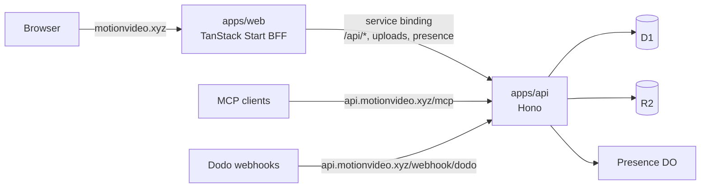

# Migrating the backend to a separate Hono API

Plan for moving MotionVideo's backend out of the TanStack Start app (`apps/web`) into its own Cloudflare Worker (`apps/api`) built on [Hono](https://hono.dev). `apps/web` becomes a backend-for-frontend (BFF): it renders pages and calls the API; the API owns data, auth, payments, uploads, and the MCP surface.

## Why

- **One backend for every client.** The site, the MCP server, scripts, and webhooks talk to one API with one contract instead of TanStack server functions that only the site can call.
- **MCP next to the data.** The MCP endpoint runs in the same isolate as D1 and R2, with no hop through the site.
- **Smaller, faster isolate for machine traffic.** MCP clients and webhooks no longer boot the SSR bundle (React, router, intlayer dictionaries).
- **Independent deploys.** UI changes don't redeploy the backend, and the reverse.

What it does **not** buy: page speed. Page loaders already run next to D1; after the split they reach it through a service binding, which is close to free but not faster. And `/api/catalog` is already cached (ETag + `s-maxage=3600`); the cheapest speed-up for it is serving `motion-catalog.json` as a static asset, which works with or without this migration.

## Where we are

One Worker, `motionvideo` (`apps/web/wrangler.jsonc`), on `motionvideo.xyz` (custom domain; `www.` redirects to the apex).

| Piece | Today |
| --- | --- |
| Worker entry | `apps/web/src/server.ts`: `www` redirect, R2 uploads under `UPLOAD_PATH_PREFIX`, prerendered pages from `ASSETS`, `/api/presence` WebSocket, security headers, then TanStack Start |
| Server functions | 32 `createServerFn`s in 8 files (below) |
| API routes | `/api/auth/$` (Better Auth), `/api/catalog`, `/api/catalog/directories`, `/api/upload`, `/api/webhook/dodo` |
| Durable Object | `Presence` (live visitors, one instance named `site`) |
| Bindings | `DB` (D1), `UPLOADS` (R2), `PRESENCE` (DO), `CONTACT_LIMITER`, `UPLOAD_LIMITER` (rate limits), `ASSETS`; preview env mirrors them |
| Data | Drizzle schemas in `src/server/db/*`, migrations in `apps/web/drizzle`, applied with `wrangler d1 migrations apply` |
| Email | React Email templates in `src/emails`, sent through Resend from `src/server/email.ts` |

Server functions by file:

| File | Functions |
| --- | --- |
| `functions.ts` | `getLandingData`, `getOffer`, `getAccount`, `getPortalUrl`, `getCheckoutResult`, `sendContactMessage` |
| `bookmark-functions.ts` | `getBookmarks`, `setBookmark` |
| `community-functions.ts` | `getSubmitter`, `getMySubmissions`, `submitCommunityEntry` |
| `feedback-functions.ts` | `sendFeedback`, `listFeedback`, `resolveFeedback` |
| `job-functions.ts` | `getJobs`, `getMyJobPosts`, `saveJobPost`, `startJobCheckout`, `listJobPosts`, `reviewJobPost` |
| `sponsorship-functions.ts` | `getDiamondSoldOut`, `getMySponsorships`, `saveSponsorDraft`, `startSponsorCheckout`, `deleteSponsorDraft`, `saveSponsorCreative`, `getSponsorPortalUrl`, `listSponsorships`, `reviewSponsorship` |
| `submission-admin-functions.ts` | `listSubmissions`, `reviewSubmission` |
| `admin-functions.ts` | `getAdminAccess` |

## Target



### Decisions

1. **The browser only ever talks to `motionvideo.xyz`.** `apps/web` stays the front door and forwards `/api/*`, upload reads, and `/api/presence` to the API through a service binding. Auth cookies stay first-party on one origin, `BETTER_AUTH_URL` doesn't change, and no CORS is needed. The forward costs one in-process call.
2. **Machines go straight to `api.motionvideo.xyz`.** MCP, Dodo webhooks, and catalog consumers hit the API Worker directly (custom domain on `apps/api`) and never boot the SSR bundle. `motionvideo.xyz/api/catalog` keeps working through the forward, so existing consumers don't break.
3. **The API owns every stateful binding.** `DB`, `UPLOADS`, `PRESENCE`, both rate limiters, all secrets (Better Auth, Dodo, Resend, Turnstile, Google). When the migration is done, `apps/web` has only `ASSETS`, an `API` service binding, and public vars.
4. **The contract is Hono RPC.** `apps/api` exports `type AppType`; `apps/web` builds a typed client with `hc<AppType>()` whose `fetch` is the service binding. External clients use the same routes over HTTPS. Input validation uses the zod schemas we already have, via `@hono/zod-validator`.
5. **One wrangler config per Worker.** `apps/web/wrangler.jsonc` and `apps/api/wrangler.jsonc`. Root scripts orchestrate both; there is no root wrangler config (one config describes one Worker, and paths resolve relative to it).

### Repository layout

```
apps/
  web/        TanStack Start BFF: routes, components, loaders calling the API
  api/        Hono Worker: routes, auth, Dodo, uploads, presence, MCP, D1 migrations
  videos/     Remotion films
packages/
  db/         Drizzle schemas (today's src/server/db/*), shared row types
  shared/     zod input schemas and constants both sides need
              (lib/sponsorships, lib/community, lib/jobs, constants/sponsors, …)
  emails/     React Email templates + render helper (used by the API only)
docs/
```

`packages/*` are plain TypeScript workspace packages (`"exports": "./src/index.ts"`), no build step; Vite and Wrangler bundle them from source. Add `packages/*` to `pnpm-workspace.yaml`.

### `apps/api` shape

```ts
// apps/api/src/index.ts
import { Hono } from "hono";

export { Presence } from "./presence";

const app = new Hono<{
  Bindings: Env;
  Variables: { session: Session | null };
}>()
  .use(sessionMiddleware) // auth.api.getSession({ headers }) once per request
  .route("/api/auth", authRoutes) // auth.handler(c.req.raw)
  .route("/api/catalog", catalogRoutes)
  .route("/api/sponsorships", sponsorshipRoutes)
  .route("/api/jobs", jobRoutes)
  // …one router per *-functions.ts file
  .route("/webhook", webhookRoutes)
  .route("/mcp", mcpRoutes);

export type AppType = typeof app;
export default app;
```

```jsonc
// apps/api/wrangler.jsonc (production part)
{
  "name": "motionvideo-api",
  "main": "src/index.ts",
  "compatibility_date": "2026-09-27",
  "compatibility_flags": ["nodejs_compat"],
  "routes": [{ "pattern": "api.motionvideo.xyz", "custom_domain": true }],
  "d1_databases": [
    {
      "binding": "DB",
      "database_name": "…",
      "database_id": "…",
      "migrations_dir": "drizzle",
    },
  ],
  "r2_buckets": [{ "binding": "UPLOADS", "bucket_name": "motionvideo-assets" }],
  "durable_objects": {
    "bindings": [{ "name": "PRESENCE", "class_name": "Presence" }],
  },
  "migrations": [{ "tag": "v1", "new_sqlite_classes": ["Presence"] }],
  "ratelimits": [/* CONTACT_LIMITER, UPLOAD_LIMITER */],
}
```

```jsonc
// apps/web/wrangler.jsonc (added)
{ "services": [{ "binding": "API", "service": "motionvideo-api" }] }
```

### Calling the API from the BFF

Server functions stay as the page-facing layer, but become thin: forward the visitor's cookie, call the API, return the JSON.

```ts
// apps/web/src/server/api.ts
import { getRequest } from "@tanstack/react-start/server";
import { env } from "cloudflare:workers";
import { hc } from "hono/client";
import type { AppType } from "@motionvideo/api";

export const api = () =>
  hc<AppType>("https://api.internal", {
    fetch: (input: RequestInfo, init?: RequestInit) =>
      env.API.fetch(input, init),
    headers: { cookie: getRequest().headers.get("cookie") ?? "" },
  });

// apps/web/src/server/sponsorship-functions.ts
export const getDiamondSoldOut = createServerFn({ method: "GET" }).handler(
  async () => (await api().api.sponsorships["diamond-sold-out"].$get()).json()
);
```

Components and loaders keep importing the same function names, so routes don't change while the backend moves underneath them.

### Local development

The Cloudflare Vite plugin runs both Workers in one `pnpm dev`, with the service binding wired up:

```ts
// apps/web/vite.config.ts
cloudflare({
  viteEnvironment: { name: "ssr" },
  auxiliaryWorkers: [{ configPath: "../api/wrangler.jsonc" }],
}),
```

Local D1 state moves with the migrations to `apps/api`; run `db:migrate:local` there once.

## Phases

Each phase ships on its own and can be rolled back by reverting the forward in `apps/web/src/server.ts`. Don't start a phase until the previous one has run in production.

### Phase 0: shared packages (no runtime change)

1. Create `packages/db` from `src/server/db/*`; move `drizzle.config.ts` and `drizzle/` with it (or to `apps/api` in phase 1; keep one owner).
2. Create `packages/shared` with the zod schemas and constants imported on both sides (`lib/sponsorships`, `lib/community`, `lib/jobs`, `lib/uploads`, `constants/sponsors`, …).
3. Create `packages/emails` from `src/emails`.
4. Point `apps/web` imports at the packages.

Done when: `pnpm typecheck`, `pnpm check`, and `pnpm build` pass; the site behaves exactly as before.

### Phase 1: scaffold `apps/api`

1. `apps/api` with Hono, `wrangler.jsonc` bound to the **same** D1 database and R2 bucket (production and preview), `GET /health`.
2. Custom domain `api.motionvideo.xyz`; Workers Builds project with root directory `apps/api`.
3. `API` service binding in `apps/web`, `auxiliaryWorkers` in its Vite config.
4. Move D1 migrations and the `db:*` scripts to `apps/api`; `deploy` in web stops running migrations.

Done when: `motionvideo-api` deploys; `env.API.fetch("/health")` answers from a web server function in dev and production.

### Phase 2: machine-facing surface

1. `GET /api/catalog` and `/api/catalog/directories` (reuse `jsonEndpoint`, or serve the JSON from the API's static assets).
2. `POST /webhook/dodo` with `syncSponsorship`, `syncSponsorPayment`, `syncJobPayment`. Point the Dodo webhook at `https://api.motionvideo.xyz/webhook/dodo` (live and test mode), keep the old route forwarding until no deliveries arrive there.
3. `/mcp`: the MCP server as a Streamable HTTP endpoint in the API Worker (MCP TypeScript SDK on Hono, or Cloudflare's `agents` `McpAgent` if sessions need a Durable Object). It queries D1 and the catalog in-process.
4. Web forwards `/api/catalog*` to the API.

Done when: MCP clients and Dodo use `api.motionvideo.xyz`; webhook redeliveries succeed; `motionvideo.xyz/api/catalog` still returns the same bytes and ETag.

### Phase 3: auth, uploads, presence

1. Better Auth on the API (`/api/auth/*`), with `baseURL` still `https://motionvideo.xyz`, because the browser reaches it through the web forward. Sign-in emails render from `packages/emails`.
2. `POST /api/upload` and upload reads (`UPLOAD_PATH_PREFIX`) on the API, with `UPLOAD_LIMITER`.
3. `Presence` moves to the API Worker. The class is already declared in web's `migrations` (`v1`, `new_sqlite_classes`), so the API either declares it fresh (`new_sqlite_classes`, starting from empty state) or takes it over with a `transferred_classes` migration from `motionvideo`. Presence state is ephemeral, so declaring it fresh is the simpler choice. Then web forwards `/api/presence` and removes its `PRESENCE` binding and the class export from `src/server.ts`, adding a `deleted_classes` migration so Cloudflare drops the old class.
4. Web forwards `/api/auth/*`, `/api/upload`, upload paths, and `/api/presence` (WebSocket upgrades pass through `env.API.fetch`).

Done when: email-code and Google sign-in, sign-out, uploads, and the live counter work in production; existing sessions survive (same D1 tables, same cookie name and origin).

### Phase 4: server functions become a BFF

Move one file at a time, in this order: public reads first, then signed-in writes, then admin.

| Order | File | Notes |
| --- | --- | --- |
| 1 | `functions.ts` | `getLandingData` is on most pages; measure it before and after |
| 2 | `bookmark-functions.ts` | small, signed-in |
| 3 | `community-functions.ts` | Turnstile check moves to the API |
| 4 | `feedback-functions.ts` |  |
| 5 | `job-functions.ts` | Dodo checkout and portal URLs come from the API |
| 6 | `sponsorship-functions.ts` | largest file; same pattern as jobs |
| 7 | `submission-admin-functions.ts`, `admin-functions.ts` | admin check (`ADMIN_EMAILS`) lives in API middleware |

For each file: add the Hono router (same zod input schemas, same errors), turn the server function into an `api()` call, delete the old implementation from `apps/web/src/server`.

Done when: `apps/web/src/server` holds only `api.ts` and thin server functions, and nothing in `apps/web` imports `drizzle-orm`, `dodopayments`, or `better-auth/*` server code.

### Phase 5: cleanup

1. Remove `DB`, `UPLOADS`, `PRESENCE`, rate limiters, and backend secrets from `apps/web/wrangler.jsonc` and the web Workers Builds settings.
2. Drop backend dependencies from `apps/web/package.json`.
3. Update `README.md` (repository table, getting started).

## Prerendering

`STATIC_PAGES` (about, brand, contact, privacy, refunds, terms) are prerendered at build time. If any of their loaders call the API, the build needs it: either keep those loaders free of API calls, or point the build at the deployed API. Check this before phase 4 step 1.

## Risks

| Risk | Mitigation |
| --- | --- |
| Session cookies break when auth moves | Same origin through the forward, same `BETTER_AUTH_URL`, same D1 tables; test sign-in on the preview env before production |
| Dodo webhooks lost during the URL switch | Keep the old route forwarding until the dashboard shows no deliveries there; the sync re-reads from the Dodo API, so redeliveries are safe |
| Durable Object move resets presence | Acceptable (ephemeral); do it in a quiet hour |
| Two deploys drift apart | Deploy the API first; keep API changes additive (new routes or optional fields) until the web is deployed |
| Forgotten binding in preview env | Mirror every production binding in `env.preview` of `apps/api/wrangler.jsonc` in phase 1 |

## Open questions

- Where the MCP server runs today and which auth it needs (public read-only, API key, or OAuth); this decides whether `/mcp` needs `McpAgent` or a plain route.
- Whether external consumers should be pointed at `api.motionvideo.xyz/api/catalog` or keep using the apex.
